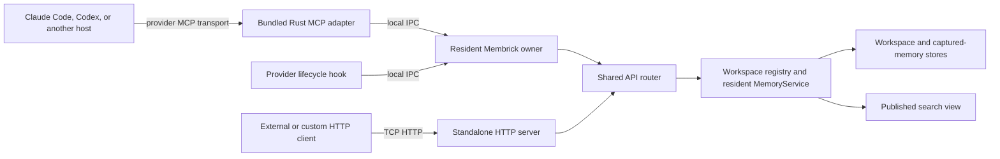

# Local IPC server architecture

Bundled Rust provider MCP adapters and lifecycle hooks send workspace requests
to a resident Membrick owner over local inter-process communication (IPC). This
keeps the local agent path off TCP, so it does not require a local HTTP listener
or depend on loopback connections being allowed by endpoint security policy.

## Request path

The agent still connects to its provider MCP adapter using the transport
configured by that agent, commonly stdio. The adapter then forwards the tool
request to the resident owner over the operating system's local IPC mechanism.
The IPC listener and standalone HTTP listener use the same application router
and `MemoryService` APIs.

The IPC client sends HTTP/1 framed JSON requests through a Unix domain socket
on macOS and Linux, or a named pipe on Windows. This reuses the existing API
routes without opening a TCP port. Bundled provider adapters use the
workspace-aware MCP tool route; their hooks use the corresponding capture and
search routes.

## Automatic startup and endpoint security

The client first tries to connect to the workspace's resident endpoint. If no
owner is available, it starts the Membrick resident-server mode for that
workspace, then retries the request while the listener starts. Concurrent
first requests coordinate through a startup marker so they share the same
owner rather than starting several writers for one workspace.

On macOS and Linux, the endpoint is under
`~/.membrick/runtime/`. The runtime directory is private to the current user
and the socket is restricted to that user. The socket name is derived from the
user and project root, so different workspaces use separate local endpoints.
Windows uses a user- and workspace-specific named pipe. Startup and listener
diagnostics go to `~/.membrick/runtime/resident.log` on Unix-like systems or
`%USERPROFILE%\\.membrick\\runtime\\resident.log` on Windows.

Bundled Rust provider adapters do not use environment variables to select the
IPC endpoint or choose between IPC and HTTP. The operating system endpoint is
resolved from the configured workspace and current user.

## Relationship to the HTTP server

The standalone HTTP API remains available for applications, custom clients,
and integrations that are configured to use HTTP. It is useful when clients
need an explicit service boundary or access from another machine. Its network
interface and authentication are configured through server settings and
command-line options.

The resident IPC listener and the standalone TCP HTTP listener are separate
server modes. Both use the same route and memory-service implementation, but a
workspace store must have only one active writer owner. Do not start a second
server against a workspace already owned by a resident IPC process. See the
[HTTP server guide](server.md) for network configuration and the
[MCP interface guide](mcp.md) for provider tools.

Some integrations, including plugins configured independently from the
bundled Rust adapters, may still call HTTP endpoints. This does not change the
transport used by bundled Rust MCP adapters and hooks.

## Local transport comparison

A short diagnostic compared the two transports through the same
`/provider-memory/mcp/tools/call` handler. Each run lasted 10 seconds with four
search callers and one writer adding one memory per call. Both used a seeded
isolated workspace, opened a fresh connection per request, returned no errors,
and made the last acknowledged write searchable.

| Transport | Search requests/s | Search p50 / p95 / p99 | Writes/s | Write p50 / p95 / p99 |
|---|---:|---:|---:|---:|
| HTTP over loopback TCP | 76.97 | 51.8 / 64.4 / 68.2 ms | 11.15 | 87.9 / 101.7 / 103.4 ms |
| Local IPC over Unix socket | 79.95 | 48.9 / 64.1 / 74.0 ms | 11.75 | 82.0 / 97.4 / 99.8 ms |

This was one short run per transport, so the small differences are within the
scope of machine and run variation. It does not show a meaningful throughput
advantage for either transport. The result indicates that using IPC does not
materially reduce throughput for this MCP workload. It does not measure Windows
named-pipe performance or large production corpora.
