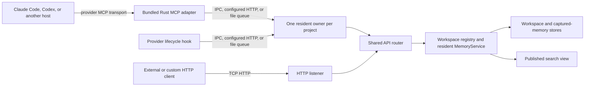

# Local IPC server architecture

Bundled Rust provider MCP adapters and lifecycle hooks send workspace requests
to one resident Membrick owner. They use local IPC first, an optional configured
loopback HTTP listener second, and a project-local file queue when socket
creation is blocked. Every transport reaches the same router, writer, and
`MemoryService` instance.

## Request path

The agent still connects to its provider MCP adapter using the transport
configured by that agent, commonly stdio. The adapter then forwards the tool
request to the resident owner over the operating system's local IPC mechanism.
The resident may expose IPC and HTTP listeners over the same application router
and `MemoryService` owner. The standalone HTTP server uses that router too, but
the workspace owner lock prevents it from opening a second writer for a project.



The IPC client sends HTTP/1 framed JSON requests through a Unix domain socket
on macOS and Linux, or a named pipe on Windows. This reuses the existing API
routes without opening a TCP port. Bundled provider adapters use the
workspace-aware MCP tool route; their hooks use the corresponding capture and
search routes.

## Automatic startup and endpoint security

The client first tries the workspace's resident IPC endpoint. If
`resident_http_bind` is configured in `.membrick/server.toml`, it next tries
that loopback HTTP listener. If both socket transports are unavailable, it
writes one atomic request file under the project's `.membrick/runtime/requests`
directory and waits for the resident to return a matching response file. If no
owner is available, the client starts resident-server mode. Concurrent first
requests coordinate through a startup marker, and a kernel-backed owner lock
prevents a second resident or standalone HTTP process from opening another
writer for the same project.

The process that starts a resident watches it until an endpoint responds.
If the child exits before binding, the starter removes only its own marker and
reports the startup failure. Other waiting clients notice the cleared marker
and fail promptly; a later request can claim startup and launch a replacement.
Failures while preparing the launch also clear the marker, so they cannot
strand future requests behind a marker for a server that was never started.

Each workspace keeps its resident socket (macOS and Linux), startup marker,
and diagnostics under its own `.membrick/runtime/` directory. On Unix-like
systems the directory is restricted to the current user and the socket is
restricted to its owner. Windows uses a workspace-specific named pipe, with
its startup marker and diagnostics in the project runtime directory. Different
project roots therefore use separate runtime state and endpoints without
requiring access to the user's home directory.

On Ctrl-C or SIGTERM the resident stops accepting connections, flushes its
writer, and removes its socket file if the path still refers to the socket it
created. A socket left by a process that was killed outright is removed by the
next owner when it fails to connect to it. The resident does not exit on its
own when idle; stop it with SIGTERM.

Project installation creates `.membrick/server.toml` when it does not already
exist. It preserves an existing file. The installed port is selected for the
project from the loopback range `8465` through `9999`; the example below shows
one possible assignment:

```toml
bind = "127.0.0.1:8080"
resident_http_bind = "127.0.0.1:8465"
resident_http_auto_port = true
dashboard_url = "http://127.0.0.1:8465/dashboard"
```

`bind` is the standalone HTTP server address. The bundled client reads
`resident_http_bind` and tries that loopback listener only after local IPC fails.
The dashboard URL points to the resident HTTP listener while the resident is
running. When multiple projects start concurrently with the same candidate, the
operating system grants the port to one resident; the other resident advances
to the next available port and atomically saves the selected bind and dashboard
URL. The HTTP fallback checks the listener's workspace identity before sending
any request, so a candidate collision can never route a project's memory call
to a different project. Later sessions for that project read the saved value. Set
`resident_http_auto_port = false` to keep a manually chosen resident port fixed.
If both socket transports are blocked, the file queue uses atomic rename to
claim each request once and routes it through the same resident router. A
timeout after a request was claimed reports that its outcome may be unknown;
Membrick does not replay the operation with a new identifier.

## Relationship to the HTTP server

The standalone HTTP API remains available for applications, custom clients,
and integrations that are configured to use HTTP. It is useful when clients
need an explicit service boundary or access from another machine. Its network
interface and authentication are configured through server settings and
command-line options.

The resident can optionally expose a TCP HTTP listener alongside IPC. The
standalone HTTP mode remains available for applications and custom clients. A
workspace store has one active writer owner across both modes; starting a second
server against that project fails before it opens the store. See the
[HTTP server guide](server.md) for network configuration and the
[MCP interface guide](mcp.md) for provider tools.

Some integrations, including plugins configured independently from the
bundled Rust adapters, may still call HTTP endpoints. This does not change the
transport used by bundled Rust MCP adapters and hooks.

## Local transport comparison

A short diagnostic compared the two transports through the same
`/provider-memory/mcp/tools/call` handler. Each run lasted 10 seconds with four
search callers and one writer adding one memory per call. Both used a seeded
isolated workspace, opened a fresh connection per request, returned no errors,
and made the last acknowledged write searchable.

| Transport | Search requests/s | Search p50 / p95 / p99 | Writes/s | Write p50 / p95 / p99 |
|---|---:|---:|---:|---:|
| HTTP over loopback TCP | 76.97 | 51.8 / 64.4 / 68.2 ms | 11.15 | 87.9 / 101.7 / 103.4 ms |
| Local IPC over Unix socket | 79.95 | 48.9 / 64.1 / 74.0 ms | 11.75 | 82.0 / 97.4 / 99.8 ms |

This was one short run per transport, so the small differences are within the
scope of machine and run variation. It does not show a meaningful throughput
advantage for either transport. The result indicates that using IPC does not
materially reduce throughput for this MCP workload. It does not measure Windows
named-pipe performance or large production corpora.
