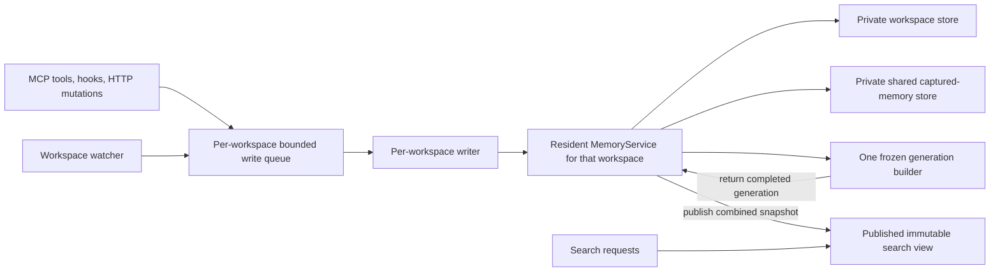

# Membrick server

`server` exposes a versioned memory API backed by `MemoryService`. The storage
engine is an implementation detail of that service; clients should use the
memory endpoints rather than depend on `IndexStore`. It is a standalone HTTP interface for any application;
`POST /add/batch` accepts up to 128 normal add requests and stages them as one
durable transaction. Accumulated changes are published on the configured
schedule. Each request still enforces the 1,024-message limit.

Identity is an API concern: `MemoryService` translates `user_id` into a generic
document filter, while `IndexStore` and segmented indexing remain unaware of
users. `group_id`/`session_id` is the core segmentation key and must not be
treated as a user identifier.
it does not require Claude Code, Codex, Gemini CLI, or Antigravity.

## Run locally

Use an explicit index directory for a persistent evaluation instance:

```bash
cargo run --release --bin server -- \
  --bind 127.0.0.1:8080 \
  --index /var/lib/membrick/memory-index \
  --server-token "$SERVER_TOKEN"
```

`--bind` defaults to `127.0.0.1:8080`. If `--index` is omitted, the server
discovers indexes under `<project-root>/.membrick` and uses the shared
`workspace-memory` store when present, falling back to a legacy Codex MCP index,
another legacy MCP index, or creates persistent `workspace-memory` when no
index exists. Use `--index` to select the workspace backing store explicitly.
Bekind linguistic enrichment is disabled by default. Pass `--bekind` to enable
its optional index-time tags and query-time analysis; when disabled, the server
does not call or prewarm the Bekind daemon.
Provider lifecycle telemetry is read from `<project-root>/.membrick/provider-telemetry`;
the project root defaults to the server's current directory and can be set with
`--project-root` or `MEMBRICK_PROJECT_ROOT`.
See [Telemetry](telemetry.md) for the telemetry streams, retention bounds,
provider coverage, privacy behavior, and dashboard endpoints.
With only `--project-root`, one server can inspect the shared workspace store
and the shared memory store in the dashboard. A project now uses this
layout:

```text
.membrick/
  workspace-memory/   # code and documentation, indexed once for the project
  memory/             # session memories, shared by all agents
```

The resident service composes `workspace-memory` with the shared `memory/`
store when publishing a generation; searches retain that published view. This
composition reuses published segments. It does not reopen either store or
rebuild indexes for each query. For attribution, the provider travels on each document (`integration`, `author_agent`,
`{provider}-session:{id}` group ids) instead of in the directory layout.
Legacy per-provider stores (`claude-memory/`, `codex-memory/`,
`gemini-cli-memory/`, `agy-memory/`, `muse-memory/`) are migrated into
`memory/` on first run and removed once their migration succeeds.
Legacy `*-mcp-index` directories are recognized for compatibility but are no
longer created.

The server publishes a segmented memory index grouped by `session_id` and routes
each search to the five most locally distinctive candidate segments.
Fixed top-5 routing remains the default. To opt into adaptive routing, pass
`--adaptive-segment-max-n N` or set `ADAPTIVE_SEGMENT_MAX_N=N`, where `N` is
greater than 5. Adaptive routing starts with the same five segments and may
expand up to `N` when the initial routes do not cover enough query evidence.
Use `--single-index` for the non-segmented layout or `--global-index` to query
every segmented shard. These modes are intended primarily for controlled
comparisons instead of the default routed segmented layout.

By default, each multi-segment query runs the routed arm only, using the
coverage-local router. Pass `--fuse-global` to also run the corpus-wide
all-segments arm and fuse it with the routed arm via reciprocal rank fusion.
See `docs/benchmark-results.md` for the measured trade-off.

The routing strategy is selectable with `--segment-routing <name>`; names match
the router comparison in `docs/benchmark-results.md`:

| `--segment-routing` value | Router |
|---|---|
| `sparse` | sparse overlap |
| `local-distinctiveness` | plain local distinctiveness |
| `coverage-local` | coverage-weighted local distinctiveness (**default**) |
| `coverage-team` | coverage team selection |
| `team-coverage-local` | team coverage local distinctiveness |
| `typed-evidence-additive` | typed evidence, additive |
| `gated-coverage-local` | gated coverage-local |
| `gated-coverage-team` | gated coverage-team |

The 500-question segmented benchmark found higher recall and MRR with
coverage-local than plain local distinctiveness, with a small latency increase
for fixed top-5 routing. On the separate 13,974-document project profile, plain
local distinctiveness had a 15 ms warm-search median; gated coverage-local
took about 700 ms. That gated strategy is distinct from the coverage-local
default. Other routing values remain selectable for controlled comparisons.

Before the single-writer consolidation, on 2026-10-11 a release server
opened the existing 13,974-document workspace
in 5.53 s and returned the first Codex MCP search in 177 ms (5 results); total
process start to first results was 5.71 s. This is a cold process with the
persistent index caches already populated. The provider MCP latency harness
then ran 20 requests per concurrency after three warm-ups. At concurrency 1,
median/p99 was 101.85/103.89 ms (9.84 requests/s); at concurrency 10,
median/p99 was 239.86/333.70 ms (37.16 requests/s). These measurements include
session handling and response serialization. The resident write-visibility
checks also passed: provider and hook writes were searchable through the
published view after their write routes completed. Raw route results are in
the [provider MCP latency report](https://github.com/RooAGI/Membrick/blob/main/comparison/results/provider-mcp-latency-refactor-2026-10-11.json).

The release query harness seeded 13,974 synthetic workspace records in 14
session groups, then ran 100 requests after 10 warm-ups. `/search` measured
478.63 requests/s at concurrency 1 (p50 2.054 ms, p99 2.457 ms) and 1,134.28
requests/s at concurrency 10 (p50 8.554 ms, p99 18.182 ms). The separate
write harness used the same seed size and two 3-second repetitions. For
single-record `/add/batch`, median accepted/published throughput was
126.97/71.67 records/s with 3.474 ms p50 latency. For 128-record batches,
throughput was 10,899.67/3,351.03 records/s with 3.987 ms p50 latency. Each
cell's final written record was searchable after flush. These synthetic
harnesses test the workspace `/search` and `/add/batch` paths; the provider MCP
latency harness above measures its route separately. Reports:
[query](https://github.com/RooAGI/Membrick/blob/main/comparison/results/throughput-query-refactor-2026-10-11.json),
[writes](https://github.com/RooAGI/Membrick/blob/main/comparison/results/throughput-write-only-refactor-2026-10-11.json).

By default the server binds only to localhost, such as `127.0.0.1:8080` or
`[::1]:8080`. To bind a container or another network interface, explicitly pass
`--allow-non-loopback` and configure `SERVER_TOKEN` or `JWT_SECRET`. This option
cannot be combined with `--allow-unauthenticated`. Keep the host port private
or place remote access behind an authenticated, encrypted proxy. See
[Run Membrick with Docker](docker.md) for a localhost-only Compose setup.

For a single-tenant deployment, also set `--tenant-id TENANT` (or
`SERVER_TENANT_ID`). Requests whose `user_id` does not match this configured
tenant are rejected; this prevents a bearer token from being used to select
another tenant by changing the request body.

For dashboard startup and use, see the [Observability guide](observability.md).
The server intentionally speaks plain HTTP because it is restricted to
localhost. Do not forward the port through a public or network-facing proxy.

Primary adds are admitted to a bounded queue and processed by one writer.
Adds arriving during refresh wait; a full queue returns `429`. Synchronous
lifecycle mutations also serialize through the mutable owner. Searches retain
the published read view throughout a rebuild.

For per-user authentication, set `JWT_SECRET`. The server accepts HS256 JWTs
with a non-empty `sub` claim and a valid `exp` claim; that subject is treated
as the authenticated `user_id` and must match the request scope. `JWT_SECRET`
takes precedence over the legacy shared `SERVER_TOKEN` mode.

The server exposes `GET /health`, the legacy mutation/search routes, and the
versioned memory routes:

* `GET /v1/memories` lists memories with `user_id`, optional `session_id`,
  `limit`, and cursor parameters.
* `POST /v1/memories` adds memories.
* `GET /v1/memories/:memory_id` retrieves one memory.
* `PATCH /v1/memories/:memory_id` updates one memory.
* `DELETE /v1/memories/:memory_id` deletes one memory.
* `POST /v1/memories/search` searches memories.
* `POST /v1/memories/refresh` publishes and checkpoints pending changes; `/flush` is an alias.

The legacy routes are `POST /add`, `POST /add/batch`, `POST /search`,
`POST /delete`, `POST /supersede`, and `POST /expire`; they remain for
backward compatibility.

Provider integrations use `POST /provider-memory/add/batch` and
`POST /provider-memory/search` for shared captured memories. The resident
`MemoryService` opens its workspace and captured-memory backing stores once
per canonical project root. Both stores are private to that owner; providers
never hold writable indexes. The batch-add endpoint has no workspace field and
targets the primary workspace. Provider search may specify a workspace;
requests without one use the primary `project_root`.

### Resident `MemoryService` ownership

For each active workspace, the server has one mutable `MemoryService` owner,
one bounded `StagedWriter` queue, and one published immutable search view. The
service owns the captured-memory store and a boxed workspace service. Server
state contains no separately writable workspace or provider owner. A registry
maps canonical project roots to these resident runtimes.



Workspace and captured-memory operations use target facades over the same
queue. A facade does not create another writer, owner, or publication gate.
`MemoryService` selects the backing store internally. MCP adds, hook upserts,
board creation and posting, update/delete/supersede/expire operations,
key-phrase backfill, and watcher reconciliation all use this queue.

The writer tracks accepted, published, checkpointed, and visible revisions
for each backing store. A workspace-wide flush captures both stores' target
revisions and waits until both are published and checkpointed. At most one
background generation builds at a time across the stores; the writer can
continue admitting staged adds while that frozen generation builds. Existing
journal recovery, receipt idempotency, and staged acknowledgement behavior
are preserved. Synchronous lifecycle and board commands drain prior staged
writes through the owner and publish the combined view before replying.
Clean stores do not require another checkpoint for every board write.

### Multiple project workspaces

One server process can serve multiple project roots. The startup
`--project-root` is opened immediately as the primary workspace. MCP tool
calls, provider hook upserts, and provider-memory searches include their
workspace root; the server canonicalizes that path and lazily opens one
resident runtime for it. The primary root is allowed by default. Additional
roots must be listed with repeatable `--workspace-root` options. Matching is
exact after canonicalization, so a request for a parent directory or an
unlisted sibling is rejected before the server opens or indexes it. For
example:

```bash
cargo run --release --bin server -- \\
  --project-root /Users/louis/sources/Membrick \\
  --workspace-root /Users/louis/sources/roo-agent-builder \\
  --max-active-workspaces 8
```

The active-workspace limit includes the primary root and defaults to 8. A
request for an allowed root beyond the resident limit returns `429`; restart
the server to release resident workspaces. Idle eviction is not implemented.
Concurrent first-open attempts reserve capacity, and only one initialization
is performed per canonical root. The runtime owns that project's workspace store,
shared provider-memory store, `MemoryService`, staged writer, published search
view, and workspace watcher. Later requests for the same canonical root reuse
that runtime. Different roots initialize independently, so opening one project
does not block searches against an already-open project.

For HTTP clients, this lets several project workspaces use the same server.
Keep it bound to loopback for a single-user setup. The primary workspace still
controls the dashboard and legacy requests that omit a workspace. HTTP MCP
clients send the workspace on each request, and writes and searches for that
root reach the same resident owner. Bundled Rust MCP adapters and hooks use the
per-workspace local IPC endpoint instead. Each active workspace remains
resident until the server exits. Do not run a second server process against the
same workspace stores; the on-disk writer is single-process. See
[Index concurrency](index-concurrency.md) for the registry, per-workspace
writer, and publication model, and [Local IPC server architecture](local-ipc-architecture.md)
for the local request path.

`POST /provider-memory/add/batch` is a compatibility exception: its request
does not contain a workspace and it writes to the primary workspace. Use the
workspace-aware MCP upsert and hook routes for additional project roots.

### Single-writer verification, 2026-10-11

The refactor passes 39 server/writer tests, 97 `MemoryService` tests, and
`cargo check --all-targets`. Coverage includes shared queue admission,
acceptance while a generation is paused, a global visibility barrier covering
both stores, recovery after a queued delete, and retained immutable views.
A board-write regression fails on the previous implementation with
`acknowledged board post is absent from the published search snapshot`, passes
with the new path, and fails again after restoring and recompiling the old
implementation.

The broader library suite has five hook-test failures that also reproduce
on the pre-consolidation source: Claude/Codex session-start directory and
session-summary formatting assertions, plus the OpenClaw legacy bootstrap
composition test. These are existing failures, separate from the passing
resident owner, queue, visibility, and recovery checks.

Paired release measurements use isolated workspaces with 13,974 synthetic
records across 14 seed batches. Query cells use 100 measured requests and
five warmups at concurrency 1 and 10. Batch-write cells use batch size 128,
eight seconds of writes, two warmups, and three repetitions.

| Measurement | Previous two writers | One resident writer |
|---|---:|---:|
| Warm `/search` p50, concurrency 1 | 1.853 ms | 1.894 ms |
| Warm `/search` p50, concurrency 10 | 8.980 ms | 9.172 ms |
| Accepted batch-write records/s, median | 5,961.83 | 6,017.54 |
| Published batch-write records/s, median including final flush | 2,786.94 | 2,902.42 |
| Batch-write acknowledgement p99, median | 5.018 ms | 5.011 ms |

These short synthetic measurements support comparable warm-query and staged
write performance; they are not a new cold-start measurement of the real
workspace or a long-duration throughput guarantee. All measured final writes
were searchable after flush. Raw results are in
`comparison/results/query-single-writer-{control,refactor}-2026-10-11.json`
and `comparison/results/write-only-single-writer-batch8s-{control,refactor}-2026-10-11.json`.
The earlier three-second write trials are retained in
`comparison/results/write-only-single-writer-{control,refactor}-2026-10-11.json`;
their batch results varied with whether a request crossed snapshot capture
at the end of the measurement window.

Codex, Claude Code, Gemini, Agy, Muse, OpenClaw, and Hermes MCP memory tools
use `POST /provider-memory/mcp/tools/call`. Each request supplies the
workspace root, provider, session, and tool arguments. The server canonicalizes
the root and routes `add_memory` through that workspace's resident writer with
the captured-memory target, while searches read its published snapshot.

Provider hooks use the same workspace owner. `POST
/provider-memory/mcp/documents/upsert` accepts either one `document` or a
`documents` batch with workspace, provider, session, and user context. The
writer publishes the complete batch before acknowledging it. Roo tool-result
replay can include `replace_group` with a
filter key and value so removed chunks disappear in the same publication.
Codex, Claude, Gemini-compatible, Agy, OpenClaw, and Roo Runtime hooks use the
resident search route for retrieval. Workspace file-change captures are also
batched through the resident writer. The backend watches the configured
workspace, reconciles Markdown changes into its retained workspace store, and
publishes them through the same writer before recording the new filesystem
fingerprint.
Bundled Rust provider hooks and MCP adapters always use a per-user local socket
(Unix domain socket on macOS/Linux, named pipe on Windows) and start the
resident owner on the first request. They do not read environment variables to
select a transport or server. This avoids local TCP firewall rules and keeps
one `MemoryService` per workspace. The standalone HTTP API remains available
to external clients and is configured through its command-line options.
The local resident service writes startup and listener diagnostics to
`~/.membrick/runtime/resident.log` (or `%USERPROFILE%\.membrick\runtime\resident.log`
on Windows); startup rotates it to one backup when it exceeds 1 MiB.

Hermes and OpenClaw plugins can share one HTTP server process. OpenClaw hook payloads with a
workspace directory are routed to that workspace's runtime. Hermes currently
uses the legacy `/provider-memory/add/batch` endpoint, which writes to the
primary workspace; its `/provider-memory/search` request can include an
optional `workspace` field. Configure their HTTP connection in each provider's
plugin configuration file. The server uses plain HTTP. Keep it on loopback for
local agent setups; for remote agents, use a separately secured tunnel or
proxy.

## Dashboard and observability

The dashboard is a read-only operational view of index health, search behavior,
and observed provider activity. Its telemetry and metrics endpoints are
documented in the [Observability guide](observability.md); provider coverage,
retention, and privacy details are in [Telemetry details](telemetry.md).

Search requests retain an independently published immutable generation. A
single mutable owner serializes writes and refreshes, while searches continue
against the last published view. Primary `/add` and `/add/batch` calls persist
and stage changes by default. Publication is triggered after 250 ms or 512
pending documents; full checkpoints run every 30 seconds. Refresh duration can
extend visibility delay beyond the scheduling interval.

Use `?wait_for_visibility=true` for an add response with immediate visibility
and final adjudication. `POST /flush` or `POST /v1/memories/refresh` publishes and
checkpoints previously accepted writes. See [the write flow and recovery
contract](index-concurrency.md#staged-writes-through-http-or-ipc) for settings, queue bounds,
shutdown, recovery and the single-process ownership requirement.

## Performance

These are HTTP service-load measurements, not retrieval-quality measurements.
Each row identifies the server state and workload. Do not treat a package
release's date as proof that a benchmark ran against that exact release: the
v0.2.1 release has no separately recorded throughput run.

The cross-system baseline is from v0.1.9. It used a 23,366-record corpus,
100 `POST /search` requests per concurrency level, `top_k: 20`, the query
`deployment configuration system decision`, and a release-mode, file-backed
single index. Latency is milliseconds; throughput is completed requests per
second.

| Concurrent requests | p50 | p90 | p99 | Throughput |
|---:|---:|---:|---:|---:|
| 1 | 6.96 ms | 7.65 ms | 28.17 ms | 139.52 req/s |
| 10 | 10.23 ms | 11.87 ms | 12.52 ms | 952.07 req/s |

The first post-refactor v0.2.0 routed-segment run used the same corpus and
query, but a different server/index implementation:

| Concurrent requests | p50 | p90 | p99 | Throughput |
|---:|---:|---:|---:|---:|
| 1 | 10.39 ms | 10.90 ms | 12.21 ms | 95.00 req/s |
| 10 | 23.71 ms | 38.02 ms | 45.89 ms | 386.55 req/s |

The v0.1.9 numbers are historical and are not a like-for-like comparison with
the segmented v0.2.0 server.

The published v0.2.0 layout comparison is the five-repetition, uncached
cold-start run from 2026-09-17. It used 23,366 records, 100 requests per cell,
`top_k: 20`, the query above, and no warm-up requests. The machine was a
MacBook Pro (Mac17,9), Apple M5 Pro (15 cores), 24 GB RAM, macOS 26.6.2, with
Rust 1.96.0, Cargo 1.96.0, and uv 0.12.7. Values are medians across the five
runs:

| Layout | C=1 throughput | C=10 throughput | C=10 p50 | C=10 p99 |
|---|---:|---:|---:|---:|
| Single index | 148.42 req/s | 997.62 req/s | 8.87 ms | 18.39 ms |
| Global segmented | 237.82 req/s | 1,306.82 req/s | 6.30 ms | 12.39 ms |
| Routed segment | 237.84 req/s | 1,512.31 req/s | 5.91 ms | 11.97 ms |

The five-run summary and raw repetitions are in
[`throughput-layout-latest.json`](https://github.com/RooAGI/Membrick/blob/main/comparison/results/throughput-layout-latest.json).
An earlier five-run cold-start experiment is preserved separately in
[`throughput-layout-cold-start-2026-09-17.json`](https://github.com/RooAGI/Membrick/blob/main/comparison/results/throughput-layout-cold-start-2026-09-17.json);
it produced different medians and must not be merged with the later run.

### Current single-index optimization diagnostic

On 2026-10-03, the optimized single-index working tree was measured once with
the same 23,366-record query workload. This is a diagnostic run, not a tagged
release result or a five-run release benchmark. It used the release server
with `agent-integrations`, 100 measured requests and 10 warm-up requests per
concurrency level, cache disabled, `top_k: 20`, and the query
`deployment configuration system decision`:

| Concurrency | p50 | p90 | p99 | Mean | Throughput |
|---:|---:|---:|---:|---:|---:|
| 1 | 3.063 ms | 3.227 ms | 3.405 ms | 3.089 ms | 322.59 req/s |
| 10 | 5.382 ms | 9.060 ms | 10.908 ms | 5.558 ms | 1,723.67 req/s |

The run used a local Darwin arm64 host; the exact hardware model was not
captured. The source was the `274b5c1` checkout with uncommitted working-tree
changes, so these numbers describe that measured build only. The full result
and command are in
[`throughput-single-index-2026-10-03.json`](https://github.com/RooAGI/Membrick/blob/main/comparison/results/throughput-single-index-2026-10-03.json).
Because this run used warm-ups and only one repetition, compare it with the
published v0.2.0 cold-start medians as directional evidence, not as a strict
apples-to-apples release regression or release claim.

Before the one-segment filter fix, global-index mode was measured once with the
same record count, query, cache setting, request count, and warm-up count. The
benchmark seeder gives all records one session ID, so the segmented snapshot
contains exactly one global segment:

| Concurrency | p50 | p90 | p99 | Mean | Throughput |
|---:|---:|---:|---:|---:|---:|
| 1 | 8.553 ms | 9.216 ms | 9.387 ms | 8.633 ms | 115.61 req/s |
| 10 | 11.536 ms | 14.595 ms | 23.462 ms | 12.259 ms | 786.29 req/s |

This is the pre-fix working-tree diagnostic. It had one repetition and its
exact hardware model and server feature set were not captured. The command and
full result are in
[`throughput-global-segmented-2026-10-03.json`](https://github.com/RooAGI/Membrick/blob/main/comparison/results/throughput-global-segmented-2026-10-03.json).

The one-segment filter fix switched this case to the same bitmap-based filter
path used by single-index mode. The rerun used the same workload and 100
requests per concurrency cell:

| Concurrency | p50 | p90 | p99 | Mean | Throughput |
|---:|---:|---:|---:|---:|---:|
| 1 | 3.066 ms | 3.248 ms | 3.476 ms | 3.098 ms | 321.60 req/s |
| 10 | 5.021 ms | 8.137 ms | 10.728 ms | 5.470 ms | 1,775.21 req/s |

That is 2.8x the pre-fix throughput at C=1 and 2.3x at C=10 in these single
runs. The after-fix result is close to the separate single-index diagnostic;
these remain working-tree measurements, not release claims. Full results are
in
[`throughput-global-one-segment-2026-10-03.json`](https://github.com/RooAGI/Membrick/blob/main/comparison/results/throughput-global-one-segment-2026-10-03.json).

#### Why the one-segment path is slower

An instrumented 10-request profile on the same workload compared this
one-segment snapshot with `--single-index`. At C=1, the global-index run
reported about 2.6–3.2 ms in filter preparation and about 3.8–4.3 ms in the
index query. The single-index control reported about 0.034–0.045 ms in filter
preparation and about 1.2–1.4 ms in the index query. The HTTP p50s in those
short profile runs were 9.18 ms versus 3.47 ms at C=1, and 21.77 ms versus
7.97 ms at C=10.

The profile explains the gap. Before the fix, when a segmented snapshot had
one segment, the query executor used `query_single_segment`, but filter
preparation still called `doc_ids_matching_filters` whenever the semantic
relation store was nonempty.
The benchmark corpus has semantic relations but no superseded documents, so
`semantic_visibility_requires_doc_ids` is false and this full string-ID
allow-list is unnecessary. The single-index path applies the user filter
directly as a bitmap. Before the fix, filter preparation took about 2.6–3.2 ms
for the segmented snapshot; after the fix it took 0.034–0.037 ms. The index
query fell from about 3.8–4.3 ms to about 1.0–1.4 ms. This confirms the
bitmap-versus-allow-list difference caused most of the gap; it is not inherent
to one segment. Relevant code is in
[`persistence.rs`](https://github.com/RooAGI/Membrick/blob/main/src/pipeline/persistence.rs)
and
[`query_plan.rs`](https://github.com/RooAGI/Membrick/blob/main/src/query_plan.rs).

#### Multi-segment routed filter cost

A follow-up profile used the same 23,366-record routed workload, once with all
records in one session segment and once spread across 23 session segments.
The query selected five segments in the multi-segment case. Filter preparation
rose from a 0.034 ms median in the one-segment case to 2.959 ms across 23
segments. Throughput fell from 304 to 124 req/s at C=1, and from 1,310 to 453
req/s at C=10. This is a short single-run diagnostic (25 requests and 3 warm-ups
per concurrency cell), not a release benchmark.

Before the fix, the multi-segment path constructed a corpus-wide set of
matching document IDs with `doc_ids_matching_filters`, then also built
per-segment filter bitmaps. The routed executor used the ID set to test segment
eligibility and intersected it into each selected segment's bitmap. When
semantic supersession does not require an ID allow-list, this duplicated
filter work. The fix now uses each segment's bitmap for eligibility and local
filtering, materializing IDs only when semantic visibility requires them.

After the fix, filter preparation measured 0.046 ms median across 23 segments,
down from 2.959 ms in the earlier short profile. A three-run, 100-request
benchmark then measured 410.72 req/s at C=1 and 1,041.78 req/s at C=10 for 23
segments; its one-segment control measured 308.09 and 1,729.84 req/s. The
multi-segment C=10 result remains lower because it executes five routed segment
queries. The earlier and follow-up runs used different request counts, so
compare their throughput only directionally. Both are working-tree diagnostics,
not release benchmarks. The result is in
[`throughput-routed-multisegment-filter-fix-2026-10-04.json`](https://github.com/RooAGI/Membrick/blob/main/comparison/results/throughput-routed-multisegment-filter-fix-2026-10-04.json);
the earlier baseline profile is in
[`throughput-routed-multisegment-profile-2026-10-04.json`](https://github.com/RooAGI/Membrick/blob/main/comparison/results/throughput-routed-multisegment-profile-2026-10-04.json).

The standalone HTTP benchmark does not initialize provider MCP watchers. Query
telemetry is recorded in memory on this request path; provider MCP telemetry
continues to use the persisted project ledger. All measurements are local
loopback results, not an internet-facing SLA; they exclude network distance,
TLS termination, and client-side processing. Benchmark scripts, workload
definitions, and artifacts are in
[`comparison/README.md`](https://github.com/RooAGI/Membrick/blob/main/comparison/README.md).

A warmed Instruments Time Profiler capture of the fixed 23-segment route ran
under C=10 load for 17 seconds (20,013 requests, 1,177 req/s, p50 8.64 ms,
p95 13.08 ms). Resolved query frames were concentrated in
`MemoryIndex::query_with_lexical_hits_timed` and its temporal-context caller.
Self samples prominently included allocator operations, hashing, stable sort,
and memory copy/compare functions. This points the next investigation toward
shard-local candidate scoring and ranking. Only 32.5% of sample rows had
resolved symbols, so the profile is directional and its raw sample counts
should not be read as CPU percentages. See
[`throughput-routed-multisegment-time-profile-2026-10-04.json`](https://github.com/RooAGI/Membrick/blob/main/comparison/results/throughput-routed-multisegment-time-profile-2026-10-04.json).

The first ranking optimization replaces full candidate sorts with partial
selection of the top 100 candidates for reranking and top 200 for final group
building, using the same deterministic comparator. In a paired three-run
23-segment diagnostic, C=1 throughput moved from 408 to 426 req/s and C=10
from 1,024 to 1,054 req/s. Median per-shard candidate-rank time moved from
0.075 ms to 0.017 ms. This is a modest throughput gain; ranking was a small
part of total query time, so further work should target candidate scoring and
accumulation. Full results are in
[`throughput-routed-partial-ranking-2026-10-04.json`](https://github.com/RooAGI/Membrick/blob/main/comparison/results/throughput-routed-partial-ranking-2026-10-04.json).

A single-segment profile on the same 23,366-record corpus measured 356 req/s
at C=1 and 1,916 req/s at C=10. The index query reported 2,404 candidates
median, with metadata scoring at 0.416 ms, compared with 0.032 ms for ranking.
The metadata loop iterates each candidate to score topic, document type, and
claim overlap. I tried iterating the candidate map mutably to remove the
temporary candidate-ID vector and redundant map lookup. The metadata loop
median fell to 0.391 ms, but three-run throughput results were mixed: C=1
moved from 356 to 360 req/s, while C=10 moved from 1,916 to 1,773 req/s.
That is not a demonstrated end-to-end gain. The
`candidate_accumulation_ms` timing covers the same loop as `metadata_ms`, so
those values overlap and must not be added. See
[`throughput-single-segment-internal-profile-2026-10-04.json`](https://github.com/RooAGI/Membrick/blob/main/comparison/results/throughput-single-segment-internal-profile-2026-10-04.json).

A follow-up sampled one candidate in every 64 to separate candidate resolution
from topic, document-type, and claim scoring. Candidate resolution averaged
124 ns per sampled candidate, topic scoring 48 ns, document-type scoring 20 ns,
and claim scoring 14 ns. This points to the two candidate-resolution map
lookups as the largest of these measured substages, with topic scoring next.
These are directional sample timings, not CPU percentages; instrumentation
adds overhead, so per-stage estimates do not sum to the metadata-loop timing.
The profile run measured 362 req/s at C=1 and 1,896 req/s at C=10, but those
throughput figures include sampling overhead. The detailed measurements are in
the profile artifact above.

The sampled substage profiler has since been removed from the query loop. The
candidate-ID vector and `candidates.entry(doc_u32).or_default()` lookup are
restored. I reran the benchmark with `MEMBRICK_QUERY_TIMINGS=1`, matching the
setting recorded for the 1,916 req/s run. Across three runs, the median was
374 req/s at C=1 and 1,922 req/s at C=10. C=10 ranged from 1,765 to 2,115
req/s, so the rerun is consistent with 1,916 within benchmark variation. The
earlier 371/1,850 run had timing unset and is a separate uninstrumented result.
The runner sets `MEMBRICK_DISABLE_QUERY_CACHE`, but current source does not read
it; effective cache behavior is the default, and the earlier artifact's
"disabled" cache label cannot be verified from current code. Results are in
[`throughput-single-segment-restored-profile-rerun-2026-10-04.json`](https://github.com/RooAGI/Membrick/blob/main/comparison/results/throughput-single-segment-restored-profile-rerun-2026-10-04.json)
and the uninstrumented run is recorded in
[`throughput-single-segment-revert-rerun-2026-10-04.json`](https://github.com/RooAGI/Membrick/blob/main/comparison/results/throughput-single-segment-revert-rerun-2026-10-04.json).

#### Routed throughput and shared Rayon pool

A later matched five-run workload compared a one-segment corpus with the same
records in 23 session segments, routing to five. With 1,000 measured requests
and 250 warm-ups per concurrency cell, C=10 median throughput was 2,477.54
req/s for one segment and 1,274.95 req/s for five routed segments. The route
scorer median was only 0.066 ms in a separate timed profile; selected segment
execution was 6.003 ms. Thus route scoring is not the source of the gap.

The Rayon pool is shared and bounded by worker count. Concurrent HTTP requests
enqueue segment tasks into that pool; they do not each create a new pool. A
fan-out sweep showed lower C=10 throughput when limiting each request to one
segment (1,011 req/s) or two (1,061 req/s), compared with the current cap of
eight (1,275 req/s). Keep pool sizing tied to CPU capacity, rather than HTTP
concurrency. Searching five indexes per request still incurs more total query
work than searching one, even when the segment searches run in parallel.

The route-width sweep improved throughput as width decreased, while retrieval
quality also decreased on a 100-question LongMemEval-S subset. Keep the route
width at five pending a larger quality run. A useful next experiment is to
start with two segments and expand toward five when results provide weak
evidence. Full benchmark tables and artifacts are in the
[throughput comparison](comparison.md#routed-segment-throughput-and-rayon-investigation-2026-10-04).

The separate stage timer supersedes older labels: `filter_ms` describes
document filtering, not route scoring, and `default_segment_execution_ms`
included coordinator setup. See the
[`throughput-routed-query-stage-profile-2026-10-04.json`](https://github.com/RooAGI/Membrick/blob/main/comparison/results/throughput-routed-query-stage-profile-2026-10-04.json)
for the definitions and full measurements.

#### Mixed read/write load

The runner seeds 23,366 records for `bench-user`, then searches that populated
user while another user writes. The earlier October 4 artifact searched an
empty user scope, so its 6,053 req/s control is not a corpus-search measurement.
The updated runner records empty responses and includes final flush time in
published write throughput. See [the corrected measurements](comparison.md#staged-write-flow-2026-10-05).

#### Write-only throughput

A separate diagnostic isolated the optimized write path: one sequential writer,
no concurrent searches, a release server using Tantivy 0.25.0, and a fresh
23,366-record index per batch size. On an Apple M5 Pro, median record throughput
was 3.42 records/s with one add per request, 13.76 with batches of eight, 26.58
with batches of 32, and 94.20 with batches of 128. The largest batch delivered
about 27.5 times the single-add record rate. Median request latency ranged from
294 ms to 1,341 ms as batch size increased. All writes succeeded and each
repetition's final record was searchable. Treat these as working-tree
diagnostics, not release capacity claims. See the [full results and setup](comparison.md#write-only-diagnostic-2026-10-05)
and [raw report](https://github.com/RooAGI/Membrick/blob/main/comparison/results/throughput-write-only-2026-10-05.json).

A follow-up profile attributed about 44% of sampled write-path CPU time to full
semantic snapshot persistence and about 35% to segment and routing-summary
refresh. Compact JSON serialization and append-only receipt persistence kept
the documented lifecycle sidecar intact. In a three-repetition rerun, single
adds measured 3.91 records/s (p50 256 ms), up from 3.42 records/s (p50 294 ms).
Batches of 128 measured 94.03 records/s (p50 1,347 ms), effectively unchanged
from 94.20 records/s (p50 1,341 ms). These remain working-tree diagnostics.
Details and raw reports are in the
[write-path profile](comparison.md#write-path-optimization-profile-2026-10-05).

At the smaller 5,000-record scale, the same test measured 2.06 ms p50 / 2.38
ms p90 at concurrency 1 and 3.79 ms p50 / 5.21 ms p90 at concurrency 10.
The current read path uses independently published immutable snapshots;
mutation work is serialized through the mutable owner and only the final snapshot swap
briefly needs the reader-facing write lock.

An initial 8-second staged-write check completed 42.53 records/s for single
adds and 259.98 records/s for batches of 128, including final flush time. This
short run has since been superseded by longer runs and later writer changes.
See [HTTP server benchmarks](http-server-benchmarks.md) for the latest
`/search`, `/add`, `/add/batch`, and mixed-load measurements.

A 65-second, three-repetition run using the default refresh schedule measured
49.12 records/s for single adds and 304.13 records/s for batches of 128,
including final flush time. This was an earlier writer revision; subsequent
measurements and optimizations are listed in the
[HTTP server benchmark page](http-server-benchmarks.md).

Memory lifecycle fields are optional on each `/add` message. Set
`expires_at_ms` to hide a memory after a Unix-millisecond deadline. Set
`supersedes_id` to mark an older memory as replaced. Lifecycle operations are
scoped by `user_id`:

```json
{"user_id":"user-0","doc_id":"memory-id"}
{"user_id":"user-0","replacement_id":"new-id","old_id":"old-id"}
{"user_id":"user-0"}
```

These are the request bodies for `/delete`, `/supersede`, and `/expire`,
respectively. Delete is idempotent; expire removes all expired memories for
the user. Search omits expired and superseded memories.

`/search` accepts `query`, `user_id`, and `top_k` (capped at 100); its optional
`options` field is retained for client compatibility. `/add` requires a
non-empty `messages` array, and each message must have a `role` of `user` or
`assistant` plus non-empty `content`. Identifiers are scoped and validated by
the server, so callers should use the same `user_id` for adding and searching
that user's memories. An add request accepts at most 1,024 messages; each
message is capped at 1 MiB, and identifiers are capped at 256 bytes.

`/add` is idempotent by `(user_id, request_id)`. The stored fingerprint is a
SHA-256 digest over the canonical `session_id` and messages; message content is
not copied into filter metadata. Reusing a request ID with a different session
or message payload is rejected.

The server token accepts `X-Api-Key`, `Authorization: Bearer <token>`, or the
raw token in `Authorization`. It can also be supplied through
`SERVER_TOKEN`.

Non-loopback binds require the explicit `--allow-non-loopback` option and
configured token or JWT authentication. The option is rejected when combined
with `--allow-unauthenticated`. `--allow-unauthenticated` is intended for
single-user localhost use only.

The server limits request bodies to 16 MiB and concurrent in-flight requests to
128. Requests time out after 30 seconds.
Malformed JSON or invalid request fields return `422`; missing or invalid
credentials return `401`; an authenticated subject or configured tenant that
does not match `user_id` returns `403`; unknown routes return `404`; an
oversized body returns `413`; a busy mutation writer returns `429`; timed-out
requests return `408`; and internal search, persistence, or publication
failures return `500`.

## Local contract smoke test

```bash
curl -sS http://127.0.0.1:8080/health

curl -sS -X POST http://127.0.0.1:8080/add \
  -H "X-Api-Key: $SERVER_TOKEN" \
  -H 'Content-Type: application/json' \
  --data '{
    "request_id": "local-run:session-0:chunk-0",
    "messages": [{"role": "user", "content": "I prefer dark mode."}],
    "user_id": "local-run:user-0",
    "session_id": "local-run:session-0"
  }'

curl -sS -X POST http://127.0.0.1:8080/search \
  -H "X-Api-Key: $SERVER_TOKEN" \
  -H 'Content-Type: application/json' \
  --data '{
    "query": "What interface preference does the user have?",
    "user_id": "local-run:user-0",
    "top_k": 100
  }'
```
